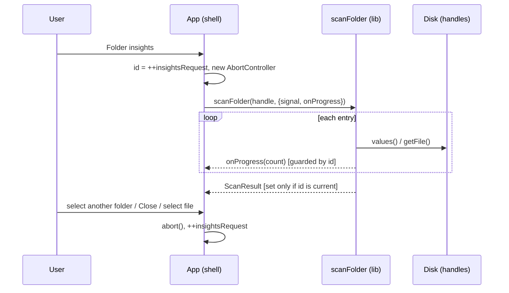

# Architecture Spine — Folio v2 Folder Insights

## Design Paradigm

**Functional core, imperative shell.** `src/lib/` is the core: plain TypeScript, pure functions, and async traversal written against structural interfaces, with no React. `src/App.tsx` (plus `src/hooks/`) is the shell: it owns all React state, browser APIs (the picker, object URLs), and decides which results are still current.

```mermaid
graph LR
  App["src/App.tsx (shell)"] --> Hooks["src/hooks/"]
  App --> Lib["src/lib/ (core)"]
  Hooks --> Lib
  App --> Tokens["src/tokens.css"]
  Lib -.x|forbidden| App
  Lib -.x|forbidden| React["react / react-dom"]
```

## Invariants & Rules

### AD-1 — `src/lib/` is framework-free [ADOPTED]

- **Binds:** all
- **Prevents:** scan or aggregation logic that only works inside a rendered component, so it can't be unit-tested.
- **Rule:** nothing under `src/lib/` imports React, JSX, `react-dom`, or touches `window`/`document`. Every exported function has a Vitest test next to it (`*.test.ts`). Browser objects come in through structural interfaces (as with `LocalFile`).

### AD-2 — Stale async results are dropped by request ID [ADOPTED]

- **Binds:** FR-7, and every async read in the shell
- **Prevents:** results from folder A showing up after folder B is selected; two different ways of cancelling.
- **Rule:** every async operation started from the shell takes `const requestId = ++ref.current` and checks `ref.current === requestId` before each `setState` (the `metadataRequest` pattern). Folder Insights uses its own ref (`insightsRequest`). It **also** passes an `AbortSignal` to the scan so the traversal stops doing work. The request ID protects correctness; the signal only saves work. Both are required.

### AD-3 — Insights reads from disk, not from the in-memory `File[]`

- **Binds:** FR-2, FR-5, FR-7, FR-11, NFR-1
- **Prevents:** one builder adding up the `File[]` loaded at pick time while another walks the disk. Their results disagree on skips, on deletions, and on what "a new scan" means.
- **Rule:** each scan walks the selected folder again through a `FileSystemDirectoryHandle` and calls `getFile()` on each file to get its size. It never reads `files` state or `ExplorerEntry.file` for totals. Consequences:
  - **FR-2:** the counter shows real progress. The in-memory set would be added up almost at once, so there would be nothing to count.
  - **FR-5:** skips are real. v1's `collectDirectoryFiles` throws on the first unreadable entry, so the in-memory set can never contain a skipped file. Only reading again lets you see unreadable files, unreadable folders, and files deleted during the scan.
  - **FR-7:** each open is a genuinely new snapshot of the folder as it is during that scan, as the glossary defines it. It does not reuse the snapshot from pick time.
- The tree, search, and detail pane keep using the in-memory `File[]`. v1 behaviour is unchanged.

### AD-4 — The root handle is kept in memory and resolved by path

- **Binds:** FR-7, FR-10
- **Prevents:** handles stored in several places, or a second picker prompt.
- **Rule:** `chooseFolder` stores the root `FileSystemDirectoryHandle` in React state next to `files` and replaces it on every new pick. It is never persisted (`.claude/rules/no-persistence.md`). The selected folder's handle is found by walking `getDirectoryHandle()` over the selected path's segments after the root name. If the walk fails, the scan fails as a whole and shows an error; this is not a skip. When the root handle is null (only the `webkitdirectory` fallback, which can't happen on desktop Chrome), the Folder insights button is not shown.

### AD-5 — The scan engine and its result shape

- **Binds:** FR-1..FR-6, FR-8, FR-11
- **Prevents:** traversal, skip counting, and ordering being split between the shell and lib; result shapes that don't match.
- **Rule:** `src/lib/folderInsights.ts` owns:
  - `scanFolder(dir, { signal, onProgress }): Promise<ScanResult>`. It takes the structural handle interfaces, which move from `App.tsx` into lib.
  - Pure synchronous `summarizeByType(records)` and `topLargest(records, 10)`, which work on `{ path, size }[]`.
  - `ScanResult = { byType: { label, size }[], largest: { path, size }[], filesProcessed, skippedFiles, skippedFolders }`.
  - Sizes are raw bytes. Formatting happens only in the shell, and only with `formatFileSize`, so FR-9 holds.
  - `path` is relative to the selected folder, joined with `/`, without the folder's own name (glossary "Full path").

### AD-6 — How skips are classified

- **Binds:** FR-5, FR-8
- **Prevents:** builders counting skips differently.
- **Rule:** if `getFile()` rejects, that is one skipped file. It still counts toward `filesProcessed` but adds no record. If iterating a subfolder (`values()`) rejects, that is one skipped folder: drop everything already collected from it and don't count it as a file. Skips never throw out of `scanFolder`. Only an abort or a failure to resolve the selected folder itself rejects.

### AD-7 — Insights file type is a separate rule from v1's `getFileType`

- **Binds:** FR-1, FR-3, FR-6
- **Prevents:** reusing `getFileType` (MIME type or `"JPG file"`), which breaks the glossary and FR-6.
- **Rule:** `getExtensionLabel(name)` in `folderInsights.ts` returns the text after the last dot, lowercased. It returns `"(no extension)"` when there is no dot or nothing after the last dot. A leading-dot name like `.env` gives `env`. v1's `getFileType` stays unchanged.

### AD-8 — Ordering uses explicit comparators

- **Binds:** FR-1, FR-4, SM-2
- **Prevents:** order that changes between runs or locales, for example `localeCompare` with locale defaults, or a sort that keeps traversal order.
- **Rule:**
  - `byType`: size descending, then label by code-unit order.
  - `largest`: size descending, then `path.toLowerCase()` by code unit, then `path` by code unit.
  - Do not use `localeCompare` here. v1's tree sort keeps its own.

### AD-9 — Cycle guard on traversal

- **Binds:** FR-11
- **Prevents:** an infinite walk, or files counted twice, through a link back to an ancestor.
- **Rule:** before descending into a subfolder, `scanFolder` checks `isSameEntry()` against every folder handle on the current ancestor chain. If any matches, the subfolder is ignored: not scanned and not reported as skipped. This guard doesn't depend on how Chromium handles links.

### AD-10 — Progress and responsiveness

- **Binds:** FR-2, NFR-1
- **Prevents:** a main-thread loop that freezes the UI; partial totals leaking into state; a re-render per file.
- **Rule:**
  - `scanFolder` reports only `filesProcessed` through `onProgress` while it runs. Records stay private until the scan resolves.
  - It yields to the event loop (a `setTimeout(0)` macrotask) at least once every 200 files.
  - The shell throttles counter state updates to about one per animation frame. The `aria-live` announcement is throttled separately to about one per second, as EXPERIENCE.md says.
  - No Web Worker.

## Consistency Conventions

| Concern | Convention |
| --- | --- |
| Naming | lib modules are camelCase nouns (`folderInsights.ts`); shell state and refs use the `insights*` prefix; tests sit next to the module as `*.test.ts` |
| Data & formats | Sizes are `number` bytes until render; paths use `/`; `formatFileSize` is the only size formatter |
| State | Insights state (`open`, `status: 'scanning'\|'done'\|'error'`, `count`, `result`) lives in `App` as React state; selecting a file sets `open=false`; changing the folder bumps `insightsRequest` and resets to `scanning`, count 0, result null |
| Errors | Scan-level failure → one inline message in the Insights view; per-entry failures → skip counts only, never an error |
| Styling | Only classes in existing CSS that use `src/tokens.css` variables; no inline styles except the existing `--depth` custom property pattern; no new CSS files [ADOPTED] |
| Files | Keep each file's existing line endings [ADOPTED] |
| Purity | No `Date.now()` or other impure calls during render [ADOPTED] |

## Stack

| Name | Version |
| --- | --- |
| React | ^19.2.8 |
| TypeScript | ~6.0.2 |
| Vite | ^8.3.0 |
| Vitest | ^5.0.5 |
| Oxlint | ^1.81.0 |
| File System Access API (`showDirectoryPicker`, `FileSystemDirectoryHandle`) | desktop Chrome |

No new dependencies.

## Structural Seed

```text
src/
  App.tsx                    # shell: root handle state, Insights view state, requestId + AbortController
  lib/
    folderInsights.ts        # handle interfaces, scanFolder, summarizeByType, topLargest, getExtensionLabel
    folderInsights.test.ts   # fake in-memory handles: skips, cycles, ordering, empty, dot-files
    fileTree.ts              # formatFileSize (reused, unchanged)
  tokens.css                 # Insights styles via existing variables
```



## Capability → Architecture Map

| Capability | Lives in | Governed by |
| --- | --- | --- |
| FR-1, FR-3, FR-6 by type | `folderInsights.ts` | AD-5, AD-7, AD-8 |
| FR-2 counter, NFR-1 | `scanFolder` + App | AD-3, AD-10 |
| FR-4 top 10 | `topLargest` | AD-5, AD-8 |
| FR-5 skips, FR-8 empty | `scanFolder` | AD-3, AD-6 |
| FR-7 lifecycle | App | AD-2, AD-3, AD-4 |
| FR-9 size format | App render | AD-5, `formatFileSize` |
| FR-10 availability | App | AD-4 |
| FR-11 links | `scanFolder` | AD-9 |

## Deferred

- **v1 `collectDirectoryFiles` failing on the first unreadable entry.** Out of scope. Insights doesn't depend on it (AD-3). Revisit if v1 load errors become a reported problem.
- **Web Worker or OPFS for scanning.** Not needed with no time target (SM-C1).
- **Splitting `App.tsx` into component files.** Allowed, but not required. AD-1 and AD-2 apply wherever the code ends up.
- **Deployment and operations.** These stay as they are: GitHub Pages deploys from `master`, CI runs `npm run build`, and `npm run check` is the local gate. Nothing in this feature changes them.
